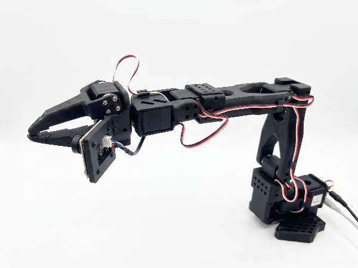

# SO101 real-hardware setup

This doc outlines how to bring up a physical SO101 follower arm, and an SO101 leader arm
for downstream tasks.

## 1. Install the driver stack

Hardware SDKs are optional extras in `mujoco_playground`, so a simulation-only checkout
never pulls them in. Add `--extra so101` to the sync for this robot:

```bash
CMAKE_ARGS="-DCMAKE_CXX_STANDARD=17" uv sync --extra cpu --extra so101 --group dev
```

`so101` is an alias for the `feetech` driver stack (`lerobot[feetech]`), shared
by every arm on a Feetech servo bus. (`CMAKE_ARGS` is needed while `reaf`
builds)

## 2. Identify your hardware

Next we'll identify the arms and camera; make sure they're plugged in.

**Arms** — identified by USB serial number, which is stable across reboots and
replugs. You will be asked to unplug one arm at a time:

```bash
uv run --extra so101 python -m mujoco_playground.robots.so101.real.get_ports --identify
```

**Cameras** — these are video devices, not serial ports, so they are identified by sight
instead: one preview frame is saved per detected camera, and you enter which
picture is the wrist camera. On macOS the first run may trigger a
camera-permission prompt for your terminal:

```bash
uv run --extra so101 python -m mujoco_playground.robots.so101.real.get_cameras --identify
```

Each command writes its config itself and prints where it lives.

The configs are machine-local and gitignored (they describe *your* physical
devices), so there is nothing to edit or commit — re-run a command if you swap
that piece of hardware. To just list what is attached without the interactive
flow, drop `--identify` from either command.

To verify it worked end to end:

```bash
uv run --extra so101 python -c "from mujoco_playground.robots.so101.real import constant, get_ports, get_cameras; print({role: get_ports.resolve(role) for role in constant.ROLES}); print(get_cameras.resolve())"
```

which should print something like:

```
{'follower': '/dev/cu.usbmodem5B610355311', 'leader': '/dev/cu.usbmodem5B3D0481941'}
{'wrist': 0}
```

On Linux the camera value is a stable `/dev/v4l/by-id/...` path. On macOS it is
an OpenCV index, which can reshuffle if you replug devices — re-run the scan if
the wrist camera stops resolving.

## 3. Calibrate both arms

Raw Feetech encoders have an arbitrary zero that depends on how each servo horn
was seated at assembly. Calibration records each joint's raw encoder tick at
the **middle pose** (see image below), and every reading and goal is thereafter
relative to that tick — so the same angle means the same physical pose on the
leader, the follower, and the simulated arm. It also records each joint's range
of motion, used as a safety clamp on goals — except for the gripper, whose
recorded range also defines its 0–100% scale, so sweep it fully.

Calibrate one arm at a time — each needs both hands, one to hold the pose and
one for ENTER. Do the follower first:

```bash
uv run --extra so101 python -m mujoco_playground.robots.so101.real.get_calibration --roles=follower
```

then the leader:

```bash
uv run --extra so101 python -m mujoco_playground.robots.so101.real.get_calibration --roles=leader
```

(Each run rewrites only that arm's entry in the calibration file. Running with
no `--roles` flag calibrates both in one go, follower then leader.)

For each arm:

1. Torque is disabled — **support the arm so it does not fall**.
2. Hold it in the **middle pose** shown below: pan centered, upper arm vertical,
   **elbow bent 90°** so the forearm is level, wrist straight, **grippers should
   be vertical** and the **camera is on the left side**. Pose it as
   consistently as you can on both arms: any mismatch between the two arms'
   reference points shows up directly as a constant teleop offset.

   

   NOTE: Because the middle pose is held by hand, manual calibration can easily
   introduce 1–2+ cm of end-effector position offset relative to nominal
   simulation forward kinematics (e.g., causing the physical arm to hover too
   high or reach too low toward the table). While downstream policies like
   `SO101PickCubeVision` train with per-episode calibration bias randomization
   (`joint_pos`, `ee_pos`, and `robot_base_pos`) to tolerate moderate offsets,
   larger offsets will eventually degrade policy performance or cause the robot
   to slam the table—re-run calibration carefully if the arm's hover height is
   visibly off by centimeters.

3. Press ENTER to capture, **keeping the arm in the pose**.
4. Move every joint except `wrist_roll` through its full range — **both
   directions from where it is**, one joint at a time — then press ENTER.
   (`wrist_roll` rotates continuously and is assigned the full encoder range
   automatically.)

The calibration is saved next to the other machine-local config (e.g.
`<repo>/.local/so101_calibration.json`), tagged with the arm's USB serial
number — the file is the single source of truth; nothing is written to the
servos. Calibration is one-time per physical arm: reboots and replugs do not
invalidate it. If you swap in a *different* arm, you should rerun calibration.

To verify:

```bash
uv run --extra so101 python -c "from mujoco_playground.robots.so101.real import get_calibration; print(get_calibration.load('follower'))"
```

NOTE: Home poses are **shared constants**, not calibration data:
[`constant.py`](constant.py) defines `LEADER_HOME`/`FOLLOWER_HOME` as the
arm's folded REST pose (not hovering). Every teleop episode, real *and* sim,
starts from this pose.

## 4. Next: collect episodes

The hardware is ready. You can now teleop the robot:
[`tasks/teleop/so101/`](../../../tasks/teleop/so101/README.md).

## Joint ordering

Real and simulated SO101 share one canonical joint order, defined by
[`constant.py`](constant.py) (the sim device re-exports it):

```
shoulder_pan, shoulder_lift, elbow_flex, wrist_flex, wrist_roll, gripper
```

## Troubleshooting

**Motors are missing from the bus, or a joint is seized.** The usual cause is
**Swapped power supplies**: the leader and
follower use different-voltage bricks with identical barrel plugs. An
underpowered arm browns out. Swap the power between the leader and the follower
to see if it fixes the issue.
