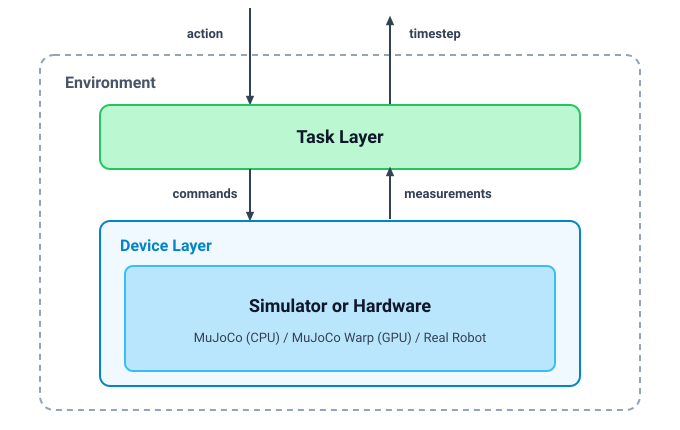
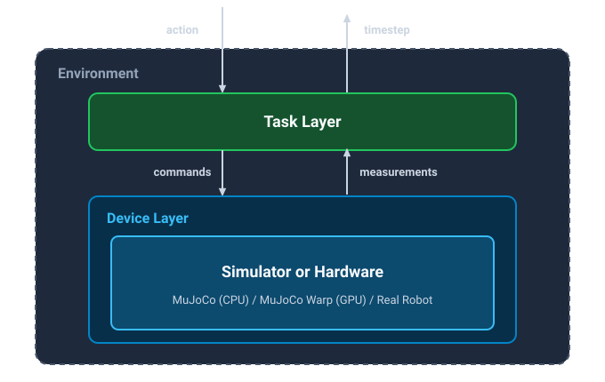

Basics
======

`reaf-sim` is the simulation instance of the `Robotics Environment Authoring Framework (REAF)
<https://github.com/google-deepmind/reaf>`_, written in `PyTorch <https://pytorch.org/>`_ and built on `MuJoCo
<https://github.com/google-deepmind/mujoco>`_ and `MuJoCo Warp <https://github.com/google-deepmind/mujoco_warp>`_.

Core Idea
---------

A strategic design choice in `REAF` is the strict architectural decoupling into two distinct layers: the :doc:`Task
Layer <task_layer>` and the :doc:`Device Layer <device_layer>`.

:doc:`Task Layer <task_layer>`:
    MDP processing of actions, observations, terminations, and rewards. Critically, this layer has **no access** to
    privileged simulation state.

:doc:`Device Layer <device_layer>`:
    Processes commands and provides measurements to the Task Layer. This layer can be simulation (e.g., MuJoCo) or
    hardware (e.g., a robot).

    **Figure 1:** Architecture of `reaf-sim`. Green components (**Task Layer**) are invariant across simulation and
    physical hardware; blue components (**Device Layer / Simulation or Hardware**) represent the
    hardware/simulation-specific implementations.

    **Figure 1:** Architecture of `reaf-sim`. Green components (**Task Layer**) are invariant across simulation and
    physical hardware; blue components (**Device Layer / Simulation or Hardware**) represent the
    hardware/simulation-specific implementations.

The :class:`~reaf.simulation.torch.DeviceLayer` interface provides seamless switching between simulation and physical
hardware without modifying :class:`~reaf.simulation.torch.TaskLayer` logic or policies.

Environment
-----------

:class:`~reaf.simulation.torch.Environment` brings together four core building blocks:

- :class:`~reaf.simulation.torch.TaskLayer` (:doc:`guide <task_layer>`): Defines rewards, observations, terminations,
  and action processing.
- :class:`~reaf.simulation.torch.DeviceLayer` (:doc:`guide <device_layer>`): Interfaces with simulation or hardware.
- :class:`~reaf.simulation.torch.Simulator` (:doc:`guide <simulator>`): Manages MuJoCo (CPU) or MuJoCo Warp (GPU)
  physics.
- :class:`~reaf.simulation.torch.EnvironmentReset` (:doc:`guide <environment_reset>`): Resets environment, device layer,
  and simulator state.

All environments implement a standard ``dm_env.Environment`` interface and conform to the GDM Environment Authoring API:

.. code-block:: python

    timestep = env.reset()
    while not timestep.last().all():
      action = policy(timestep.observation)
      timestep = env.step(action)

    # Reset specific worlds
    env_mask = torch.tensor([True, False], device=env.xpu_device)
    timestep = env.reset_with_options(
        options=env.default_reset_options(),
        env_mask=env_mask,
    )

    # Query action and timestep specs
    action_spec = env.action_spec()
    timestep_spec = env.timestep_spec()

Batching Conventions
--------------------

Tensors carry a leading ``nworld`` (i.e., batch) dimension:

.. code-block:: python

    assert timestep.reward.shape == (4096,)
    assert timestep.step_type.shape == (4096,)
    assert timestep.observation["joint_pos"].shape == (4096, num_joints)

Config Language
---------------

Environments in `reaf-sim` can be declaratively configured using the :doc:`flat_scene <flat_scene>` configuration
language.

.. code-block:: python

    from reaf.simulation.torch import ActuatorDevice, CameraDevice, flat_scene

    config = flat_scene.Environment(
        base_scene=spec,
        sim=flat_scene.Sim(nworld=1024, xpu_device="cuda:0", impl="warp"),
        device_layer=flat_scene.DeviceLayer(
            devices={
                "arm": flat_scene.Component(
                    ActuatorDevice, targets=["joint1", "joint2"]
                ),
                "camera": flat_scene.Component(
                    CameraDevice,
                    cam_name="wrist",
                    cam_resolution=(128, 128),
                    render_rate_hz=20.0,
                ),
            }
        ),
        task_layer=flat_scene.TaskLayer(
            rewards={"distance": flat_scene.Reward(reach_goal_reward, weight=1.0)},
            terminations={"bounds": flat_scene.Term(workspace_bounds_checker)},
        ),
        episode_length_secs=10.0,
    )

    env = flat_scene.build_env(config)
