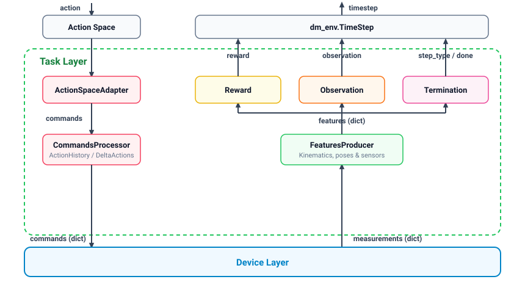
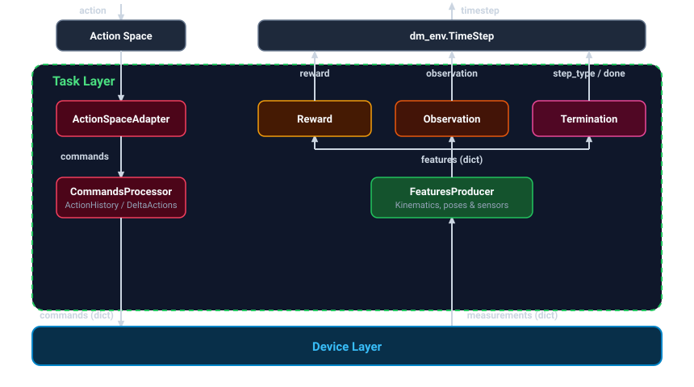

Task layer
==========

:class:`~reaf.simulation.torch.TaskLayer` defines a Markov Decision Process (MDP): processing actions into device
commands, extracting task features from device measurements, and computing rewards, terminations, metrics, and
observations.

Importantly, :class:`~reaf.simulation.torch.TaskLayer` has **no direct access to privileged simulation information** and
operates strictly on information provided via the layer interface. This information boundary enables unmodified
:class:`~reaf.simulation.torch.TaskLayer` code to directly interface with different simulation backends or physical
robot hardware.

    **Figure 1:** Information flow in :class:`~reaf.simulation.torch.TaskLayer`. Actions map to device commands; device
    measurements expand into features, which construct rewards, terminations, and observations.

    **Figure 1:** Information flow in :class:`~reaf.simulation.torch.TaskLayer`. Actions map to device commands; device
    measurements expand into features, which construct rewards, terminations, and observations.

The `REAF documentation <https://reaf.readthedocs.io/en/latest/core_concepts/#task-layer>`_ provides additional details
about the task layer design.

Commands
--------

Before policy actions reach devices, ``CommandsProcessor`` components (such as
:class:`~reaf.simulation.torch.DeltaActions` and :class:`~reaf.simulation.torch.TransformActions`) can intercept,
transform, scale, or buffer them.

Features
--------

:class:`~reaf.simulation.torch.FeatureProducer` components compute derived physical quantities from raw device
measurements. These are collected into a consolidated features bus, ensuring geometric calculations (such as
end-effector frames, relative distances, or filtered velocities) are performed exactly once per step.

Rewards
-------

Rewards are configured declaratively using :class:`~reaf.simulation.torch.flat_scene.Reward`.

By default, :class:`~reaf.simulation.torch.FunctionalRewardProvider` computes the scalar reward as the weighted sum of
terms scaled by the control timestep:

.. code-block:: text

    r_t = control_timestep * sum(weight_i * term_func_i(features))

Metrics
-------

Diagnostic metrics are configured declaratively using :class:`~reaf.simulation.torch.flat_scene.Metric` with an explicit
per-episode reduction mode (``reduce="mean" | "last" | "max" | "sum"``):

.. code-block:: python

    metrics = {
        "tracking_error": flat_scene.Metric(pose_error, reduce="mean"),
        "peak_height": flat_scene.Metric(object_height, reduce="max"),
        "contact_events": flat_scene.Metric(new_contact_event, reduce="sum"),
        "success": flat_scene.Metric(goal_reached, threshold=0.02, reduce="last"),
    }

- **Per-episode metrics**: ``env.task_layer.get_episode_metrics(env_mask)`` returns ``dict[str, torch.Tensor]`` of 0-D
  scalar means over the masked worlds without host-device synchronization.

Terminations and discounts
--------------------------

Episode endings distinguish between task failure/completion (termination) and time limits (truncation).

- **Task terminations**: Evaluated by :class:`~reaf.simulation.torch.FunctionalTerminationChecker` based on criteria
  from features.
- **Timeouts**: Handled automatically by :class:`~reaf.simulation.torch.TimeoutTerminationChecker` based on
  ``episode_length_secs`` in the environment configuration.
- **Discounts**: Computed by :class:`~reaf.simulation.torch.DefaultDiscountProvider`, emitting ``gamma = 0.0`` on
  termination (task failure/success) and ``gamma = 1.0`` on truncation (timeout) or continuation.

Observation adapters
--------------------

:class:`~reaf.simulation.torch.FunctionalObservationAdapter` organizes features into named
:class:`~reaf.simulation.torch.flat_scene.ObsGroup` dictionaries (e.g., ``"policy"``, ``"critic"``,
``"proprioception"``). Each :class:`~reaf.simulation.torch.flat_scene.Obs` term supports declarative data
transformations evaluated in order: ``func -> bias -> noise -> scale -> offset -> clip -> history``.

Task layer assembly
-------------------

Task components assemble inside :class:`~reaf.simulation.torch.flat_scene.Environment`:

.. code-block:: python

    from reaf.simulation.torch import flat_scene

    config = flat_scene.Environment(
        base_scene=spec,
        device_layer=device_layer_config,
        task_layer=flat_scene.TaskLayer(
            command_processors=command_processors,
            feature_producers=feature_producers,
            command_feature_producers=command_feature_producers,
            rewards=rewards_dict,
            metrics=metrics_dict,
            terminations=terminations_dict,
        ),
        observation_adapter=observation_adapter,
        episode_length_secs=10.0,
    )

    env = flat_scene.build_env(config)

For full class signatures and details, see :class:`reaf.simulation.torch.TaskLayer` in the :doc:`API reference
<../api>`.
